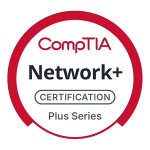

<h1 align="center">Hi there, I'm Nelson 👋</h1>

I'm a student at Normandale Community College and am currently on the Computer Science Transfer Pathway. I'm deeply interested in IT systems, cybersecurity, and programming languages.

<h2 align="center">💼 Experience</h2>

**IT Help Desk Assistant** · Normandale Community College ·
*Oct 2026 – Present* (part-time, work-study)
- Verify user identity (school ID) before resetting account passwords for students and staff.
- Troubleshoot and resolve common printer issues.
- Learning to document and track support requests in the ticketing system.

<h2 align="center">🚀 Technology and Tools</h2>

  

  
  
  
  
  
  
  
  
  
  
  
  
  
  

<h2 align="center">🎯 Certifications</h2>

  
   
  <strong>CompTIA Network+</strong>
   
  <em>In Progress</em>

<h2 align="center">🌍 Languages</h2>

  
  
  
  

<h2 align="center">📪 Connect</h2>

  
  &nbsp;&nbsp;
  
  &nbsp;&nbsp;
  

